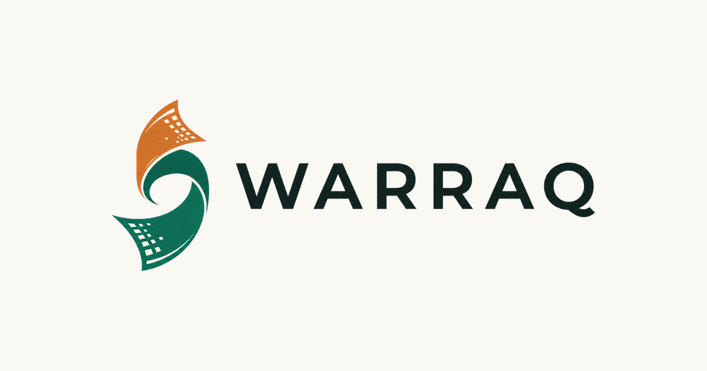

<h1>
  
  Warraq — Public Catalog Website
</h1>

Public-facing Next.js site for the Mustapha Bacha Hospital library. Read-only browse/search
over the same Supabase database the [Warraq desktop app](../App) uses, via the `anon` role
and the `catalog_*_public_read` RLS policies defined in `App/supabase/migrations/0004_rls.sql`.

**Status:** Landing page plus catalog browse/search with external lookup links are functional, following a recent catalogue UI redesign.

## Project identity

<p align="center">
  <a href="https://warraq-website.vercel.app">
    
  </a>
</p>

The image links to the live catalog at [warraq-website.vercel.app](https://warraq-website.vercel.app).

## Tech

Next.js (App Router) · TypeScript · Tailwind CSS · `@supabase/supabase-js`

## Getting started

```bash
pnpm install
pnpm dev
```

Copy `.env.example` to `.env.local` and fill in the project's Supabase URL and anon
(publishable) key — the same public values used by the desktop app's `VITE_SUPABASE_*` vars.

## Project structure

```text
src/
|-- app/
|   |-- page.tsx              # Landing page
|   |-- catalog/page.tsx      # Search/browse catalog
|   |-- catalog/[id]/page.tsx # Book detail
|-- components/                # Header, BookCard, SearchForm
|-- lib/
|   |-- supabase.ts            # Supabase client (anon key)
|   |-- catalog.ts             # Catalog queries
```

## Scripts

- `pnpm dev` — start the dev server
- `pnpm build` — production build
- `pnpm lint` — ESLint
